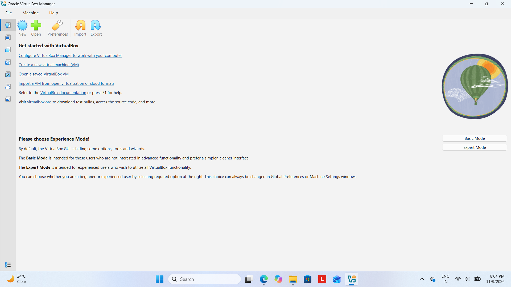
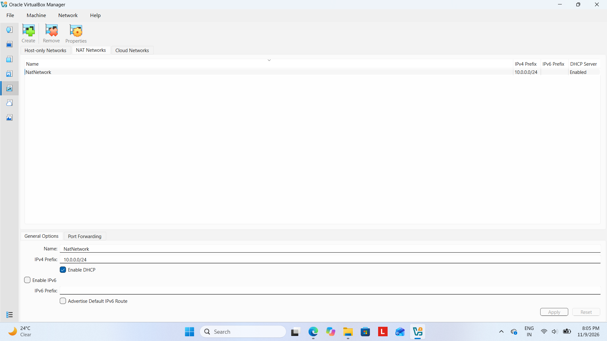
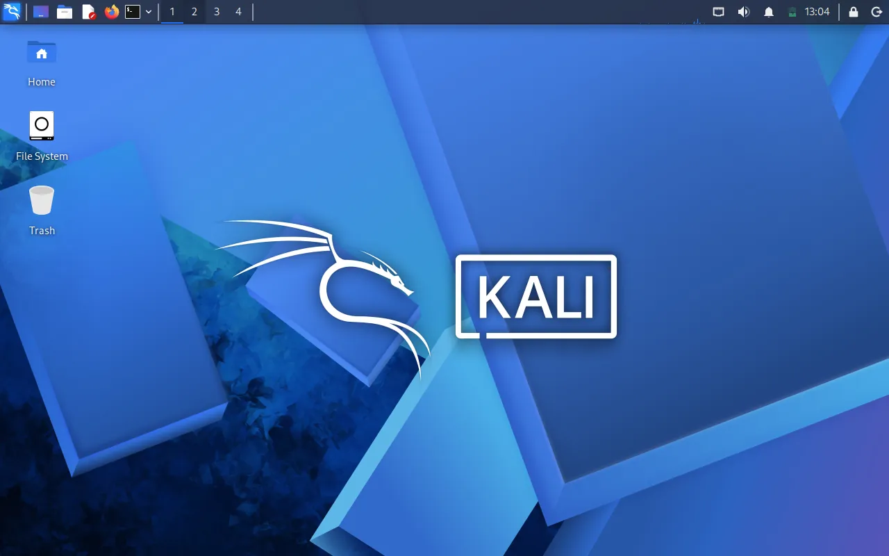
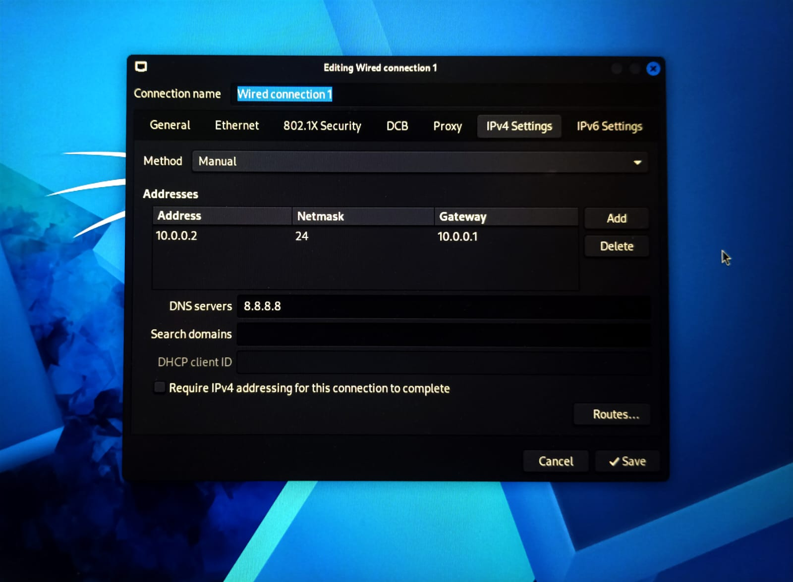

<div align="center">

# 🔐 Cybersecurity Home Lab Setup

**An isolated VirtualBox + Kali Linux lab for ethical hacking and penetration-testing practice**

<p align="center">
  
  
  
  
  
  
  
  
  
  
</p>

</div>

---

## 📌 Overview

This project documents how I built a **virtual cybersecurity lab** using VirtualBox and Kali Linux. The lab runs on a private **NAT Network**, so more machines can be added later as targets for authorized security testing.

> ⚠️ **Ethical use:** This lab is for education only. Test only systems you own or have explicit permission to test.

---

## 🧩 Lab Configuration

| Component | Configuration |
| --------- | ------------- |
| 🧰 Hypervisor | Oracle VirtualBox |
| 🐉 Security OS | Kali Linux (VM) |
| 🌐 Virtual Network | NAT Network – `NatNetwork` |
| 📡 Network Address | `10.0.0.0/24` (DHCP enabled, IPv6 disabled) |
| 🐧 Kali IP Address | `10.0.0.2/24` (static) |
| 🚪 Default Gateway | `10.0.0.1` |
| 🌍 DNS Server | `8.8.8.8` |

---

## 🪜 Setup Steps

### Step 1 – Install VirtualBox

Installed Oracle VirtualBox as the hypervisor and launched VirtualBox Manager.



---

### Step 2 – Create the NAT Network

Created a dedicated NAT Network in **Tools → Network → NAT Networks**:

```text
Name:         NatNetwork
IPv4 Prefix:  10.0.0.0/24
DHCP:         Enabled
IPv6:         Disabled
```

A NAT Network lets multiple VMs talk to each other while still having outbound internet access, which is ideal for an attacker + target lab.



---

### Step 3 – Import Kali Linux

Imported the official Kali Linux VM into VirtualBox and set **Adapter 1** to *NAT Network* → `NatNetwork`.



---

### Step 4 – Configure a Static IP on Kali

Edited the wired connection in Kali's network settings (**IPv4 Settings → Method: Manual**):

```text
IP Address: 10.0.0.2
Netmask:    24
Gateway:    10.0.0.1
DNS:        8.8.8.8
```

A fixed IP makes the lab easier to document and reference in later exercises.



---

## 🔎 Verification

Run these inside Kali to confirm the lab works:

| Test | Command | Expected Result |
| ---- | ------- | --------------- |
| Check IP | `ip a` | Shows `10.0.0.2/24` |
| Ping gateway | `ping 10.0.0.1` | Replies received |
| Ping internet | `ping 8.8.8.8` | Replies received |
| DNS resolution | `nslookup google.com` | Domain resolves |
| Verify Nmap | `nmap --version` | Version displayed |

---

## 💡 What I Learned

- **NAT vs NAT Network:** a NAT Network lets VMs communicate with each other, plain NAT does not.
- **VM networking:** how VirtualBox adapters connect machines and affect communication.
- **Static IP configuration:** setting and verifying IP, netmask, gateway, and DNS in Kali.
- **Documentation:** recording commands, screenshots, and fixes is part of professional security work.

---

## 🚀 Next Steps

- Take a clean VM snapshot as a recovery baseline
- Add a vulnerable target VM to `NatNetwork`
- Practice scanning with Nmap and documenting findings

---

## 🔗 Tools & Resources

- **VirtualBox:** https://virtualbox.org/wiki/Downloads
- **Kali Linux:** https://kali.org/get-kali

---

## 👤 Author

**Priti Shete**

LinkedIn: [linkedin.com/in/shetepriti80](https://www.linkedin.com/in/shetepriti80)
